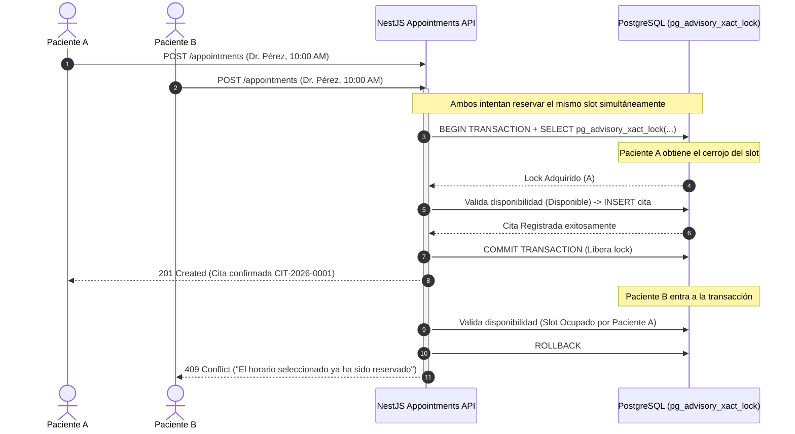

<p align="center">
  
</p>

<h1 align="center">🏥 CitasSistema — SaaS Clínico & Gestión Médica Multi-Tenant</h1>

<p align="center">
  <strong>Plataforma integral empresarial de gestión médica, historia clínica electrónica (HCE), telemedicina asistida por IA, control financiero POS y reservas en tiempo real con aislamiento multi-inquilino.</strong>
</p>

<p align="center">
  <a href="https://github.com/Alessander9/SistemaCitas_ok/actions"></a>
  <a href="https://github.com/Alessander9/SistemaCitas_ok"></a>
  <a href="https://github.com/Alessander9/SistemaCitas_ok"></a>
  <a href="https://github.com/Alessander9/SistemaCitas_ok"></a>
  <a href="https://github.com/Alessander9/SistemaCitas_ok"></a>
  <a href="https://github.com/Alessander9/SistemaCitas_ok"></a>
  <a href="https://github.com/Alessander9/SistemaCitas_ok/blob/main/LICENSE"></a>
</p>

---

## 📑 Tabla de Contenidos

- [🌟 Visión General](#-visión-general)
- [🏛️ Arquitectura del Sistema](#️-arquitectura-del-sistema)
- [✨ Módulos y Funcionalidades Principales](#-módulos-y-funcionalidades-principales)
  - [1. 📅 Motor de Citas con Anti-Colisión Concurrente](#1--motor-de-citas-con-anti-colisión-concurrente)
  - [2. 🩺 Consulta Médica y Expediente Clínico (HCE)](#2--consulta-médica-y-expediente-clínico-hce)
  - [3. 🤖 Telemedicina & Asistente Clínico IA](#3--telemedicina--asistente-clínico-ia)
  - [4. 💳 Pagos Idempotentes, Caja Chica y Kardex](#4--pagos-idempotentes-caja-chica-y-kardex)
  - [5. 📲 Automatizaciones Omnicanal (Telegram & WhatsApp)](#5--automatizaciones-omnicanal-telegram--whatsapp)
  - [6. 📊 Dashboards con Control de Acceso (RBAC)](#6--dashboards-con-control-de-acceso-rbac)
- [🛠️ Stack Tecnológico](#️-stack-tecnológico)
- [🗄️ Modelo de Base de Datos y Multi-Tenancy](#️-modelo-de-base-de-datos-y-multi-tenancy)
- [🚀 Puesta en Marcha (Guía Rápida)](#-puesta-en-marcha-guía-rápida)
- [🧪 Pruebas y Calidad de Código](#-pruebas-y-calidad-de-código)
- [🔐 Seguridad y Cumplimiento Normativo](#-seguridad-y-cumplimiento-normativo)
- [📄 Documentación de Referencia](#-documentación-de-referencia)

---

## 🌟 Visión General

**CitasSistema** es una solución de grado médico diseñada para clínicas multidisciplinarias, policlínicos y centros de fisioterapia y rehabilitación física. Resuelve de forma nativa los desafíos críticos del sector:

1. **Aislamiento Multi-Tenant Estricto**: Varias clínicas operan sobre la misma infraestructura sin riesgo de fuga o contaminación cruzada de información.
2. **Cero Dobles Reservas (Zero Double-Booking)**: Bloqueo transaccional atómico mediante advisory locks de PostgreSQL ante alta concurrencia.
3. **Optimización Extrema de Rendimiento**: Carga diferida (`React.lazy`) con división de bundle optimizada (<310 kB) y soporte de pool dinámico de base de datos.
4. **Asistencia Médica Inteligente**: Asistente por voz para consultas clínicas, mapeo anatómico interactivo (*BodyMapPicker*) y prescripciones digitales instantáneas.

---

## 🏛️ Arquitectura del Sistema

El sistema implementa un **Monolito Modular con Clean Architecture** en el Backend y una **SPA Componentizada por Tokens de Diseño** en el Frontend.

```mermaid
flowchart TB
    subgraph CLIENTS ["🖥️ Clientes & Canales de Entrada"]
        WEB_PUB["🌐 Web Pública & Booking Wizard"]
        PORTAL_PAC["👤 Portal Privado del Paciente"]
        PORTAL_MED["👨‍⚕️ Portal Médico & Clínico"]
        PORTAL_ADM["📊 Dashboard de Administración & Caja"]
        BOT_TG["📱 Bot de Telegram"]
        WHATSAPP["💬 Recordatorios WhatsApp API"]
    end

    subgraph GATEWAY ["🛡️ Seguridad & Routing (NestJS API Gateway)"]
        AUTH_GUARD["🔑 JwtAuthGuard (Token Rotation)"]
        TENANT_GUARD["🏢 TenantGuard (Header & JWT Tenant Isolation)"]
        RBAC_GUARD["🛡️ RolesGuard & PermissionsGuard"]
        RATE_LIMITER["⏱️ Throttler (DDoS & Brute Force Protection)"]
    end

    subgraph MODULES ["📦 Módulos de Negocio Backend"]
        AUTH_MOD["🔐 AuthModule"]
        APPT_MOD["📅 AppointmentsModule\n(pg_advisory_xact_lock)"]
        CLINICAL_MOD["🩺 ClinicalModule\n(SOAP, Escala EVA, Recetas)"]
        PAY_MOD["💳 PaymentsModule\n(Idempotency & Webhooks HMAC)"]
        CASH_MOD["💵 CashModule & Kardex"]
        AI_MOD["🤖 AiAssistantModule\n(NLP & Voice Synthesis)"]
        NOTIF_MOD["📲 TelegramModule & Notifications"]
    end

    subgraph STORAGE ["🗄️ Capa de Datos & Persistencia"]
        PG_DB[("🐘 PostgreSQL 16+\n(13 Migraciones DDL + Advisory Locks)")]
        POOLS["⚡ Conexión Connection Pooling (pg.Pool)"]
    end

    CLIENTS --> GATEWAY
    GATEWAY --> MODULES
    MODULES --> POOLS
    POOLS --> PG_DB
```



---

## ✨ Módulos y Funcionalidades Principales

### 1. 📅 Motor de Citas con Anti-Colisión Concurrente
- **Algoritmo de Disponibilidad en Tiempo Real (`/availability`)**: Cruce dinámico de horarios semanales del profesional, días feriados, bloqueos programados y citas activas.
- **Bloqueo Atómico de Concurrencia**: Uso de `SELECT pg_advisory_xact_lock(hashtext(...))` para serializar peticiones simultáneas sobre el mismo médico y fecha sin generar bloqueos globales.
- **Ciclo de Vida Integral de Citas**: Transiciones automáticas auditadas (`pending` ➔ `confirmed` ➔ `checked_in` ➔ `in_progress` ➔ `completed` / `cancelled` / `no_show`).



---

### 2. 🩺 Consulta Médica y Expediente Clínico (HCE)
- **Historia Clínica Digital Inmutable**: Registro estructurado según directiva médica con motivo de consulta, antecedentes, examen físico y diagnóstico CIE-10.
- **Mapeo de Dolor Interactivo (BodyMapPicker)**: Selección visual de zonas corporales dolorosas (frontal y dorsal) con registro de intensidad en la **Escala Visual Analógica EVA (0-10)**.
- **Evolución Terapéutica**: Registro de alivio del dolor (`pain_scale_before` vs `pain_scale_after`) y trazabilidad de técnicas kinesiológicas aplicadas.
- **Generador de Recetas Médicas Digitales**: Impresión estructurada con medicamentos, posología, contraindicaciones y firma médica.

---

### 3. 🤖 Telemedicina & Asistente Clínico IA
- **Voice Consultation Assistant**: Transcripción por voz en tiempo real con extracción automática de entidades clínicas (síntomas, signos vitales, diagnóstico preliminar) para acelerar el llenado de la ficha médica.
- **Widget de Chat IA Omnipresente**: Soporte conversacional para pacientes con detección inteligente de intención y orientación de citas.

---

### 4. 💳 Pagos Idempotentes, Caja Chica y Kardex
- **Patrón Strategy de Pagos**: Soporte unificado para cobros manuales (Efectivo, Yape, Plin, Transferencia) y pasarelas de pago online.
- **Idempotencia Estricta (`idempotency_key`)**: Prevención de cobros dobles ante reintentos de red o pulsaciones múltiples.
- **Webhooks con Firma Criptográfica HMAC-SHA256**: Validación segura con `crypto.timingSafeEqual` ante ataques de temporización.
- **Caja Chica (POS)**: Control de aperturas de turno, arqueos ciegos, registro de egresos/ingresos menores y balance en tiempo real.
- **Kardex de Insumos**: Descuento automático de stock de insumos por sesión terapéutica realizada con alertas de stock mínimo.

---

### 5. 📲 Automatizaciones Omnicanal (Telegram & WhatsApp)
- **Bot de Telegram para Profesionales**: Vinculación segura de cuenta mediante código OTP temporal (`generate-link-code`), recepción de agenda diaria y alertas instantáneas de nuevas citas o cancelaciones.
- **Recordatorios de WhatsApp**: Modal interactivo de recepción para despacho directo de recordatorios a pacientes con plantilla personalizada y un solo clic.

---

### 6. 📊 Dashboards con Control de Acceso (RBAC)
Paneles de control a medida para cada perfil con métricas e indicadores de gestión (KPIs):
- 👑 **Super Admin Dashboard**: Control global de clínicas multi-tenant, planes y consumo de recursos.
- 🏢 **Clinic Admin Dashboard**: Ingresos del mes, tasa de ocupación médica, citas por especialidad y gestión de personal.
- 👨‍⚕️ **Doctor Dashboard**: Agenda de hoy, pacientes en espera, acceso directo a la consulta clínica y recetas emitidas.
- 📋 **Reception Dashboard**: **Kanban Board** interactivo de flujo de sala (`checked_in` ➔ `in_consultation` ➔ `completed`) y cobro en caja.
- 👤 **Patient Portal**: Próximas citas, historial médico descargable, recetas y evolución del dolor.

---

## 🛠️ Stack Tecnológico

| Capa | Tecnología | Propósito |
| :--- | :--- | :--- |
| **Frontend Framework** | `React 19` + `TypeScript 5.7` | Interfaz reactiva y tipado estricto |
| **Build & Tooling** | `Vite 6` + `PostCSS` | Bundling ultra-rápido y HMR instantáneo |
| **Estilos & Diseño** | `Vanilla CSS Tokens` + `Dark Theme` | Sistema de diseño profesional sin dependencias pesadas |
| **Backend Framework** | `NestJS 11` + `Express` | Arquitectura empresarial modular e inyección de dependencias |
| **Base de Datos** | `PostgreSQL 16+` | Base de datos relacional ACID con soporte transaccional |
| **Capa de Conexión** | `pg` (node-postgres) + Pool | Control de conexiones optimizado (`DB_POOL_MAX`) |
| **Autenticación** | `Passport JWT` + `Bcrypt` | Tokens rotativos seguros (Access 15m / Refresh 7d) |
| **Seguridad Criptográfica** | `HMAC-SHA256` + `Crypto` | Validación de webhooks de pagos anti-tampering |
| **Pruebas Frontend** | `Vitest` + `React Testing Library` | 56 tests unitarios y de integración de UI |
| **Pruebas Backend** | `Jest` + `Supertest` | 142 tests unitarios, guards y regresión global |
| **Linter & Calidad** | `ESLint 9` + `Prettier` | 0 errores en monorepositorio |

---

## 🗄️ Modelo de Base de Datos y Multi-Tenancy

El repositorio incluye **13 migraciones SQL estructuradas** ejecutadas en orden secuencial:

```
db/migrations/
├── 001_extensions_and_enums.sql                     # UUID, CITEXT, Enums de estado y roles
├── 002_tenants_users_roles.sql                      # Clínicas (Tenants), Usuarios y Roles RBAC
├── 003_medical_tables.sql                           # Especialidades, Servicios y Profesionales
├── 004_patients_appointments.sql                    # Pacientes, Citas y Trazabilidad de estados
├── 005_financial.sql                                # Transacciones de pago y comprobantes
├── 006_clinical.sql                                 # Historias clínicas, Diagnósticos CIE-10 y Recetas
├── 007_operational.sql                              # Auditoría, Notificaciones y Configuración
├── 008_auth_refresh_tokens.sql                      # Rotación segura de refresh tokens JWT
├── 009_payments_idempotency.sql                     # Control de idempotencia y Webhook events
├── 010_clinical_pain_scale_and_sessions.sql         # Escala EVA 0-10 y Sesiones terapéuticas
├── 011_cash_session_and_inventory_adjustments.sql   # Sesiones de caja chica, Kardex y Stock
├── 012_telegram_professional_linking.sql            # Códigos OTP de vinculación con Telegram
└── 013_performance_and_security_indexes.sql         # Índices compuestos optimizados (B-Tree/GIST)
```

---

## 🚀 Puesta en Marcha (Guía Rápida)

### Prerrequisitos
- **Node.js**: `v20.x` o superior
- **npm**: `v10.x` o superior
- **PostgreSQL**: `v15.x` o `v16.x` en ejecución local o en la nube (ej. Supabase)

### 1. Clonar el repositorio e instalar dependencias
```bash
git clone https://github.com/Alessander9/SistemaCitas_ok.git
cd SistemaCitas_ok

# Instalar todas las dependencias del monorepositorio
npm install
```

### 2. Configurar variables de entorno
Crea un archivo `.env` en la raíz del proyecto tomando como base [.env.example](file:///c:/Users/Alessander/Desktop/SistemaCitas_OK/.env.example):

```env
# Servidor
PORT=3000
NODE_ENV=development

# Base de Datos PostgreSQL
DB_HOST=localhost
DB_PORT=5432
DB_USER=postgres
DB_PASSWORD=tu_password
DB_NAME=sistemacitas
DB_SSL=false
DB_POOL_MAX=20

# Seguridad JWT
JWT_SECRET=super_secret_jwt_key_development_32_chars
JWT_EXPIRES_IN=15m
JWT_REFRESH_SECRET=super_secret_refresh_jwt_key_32_chars
JWT_REFRESH_EXPIRES_IN=7d

# Webhooks & Integraciones
WEBHOOK_SECRET=secret_webhook_signature_hmac
TELEGRAM_BOT_TOKEN=tu_token_de_telegram_bot
```

### 3. Ejecutar las migraciones y datos demo
```bash
# Ejecutar migraciones SQL en tu base de datos PostgreSQL
psql -h localhost -U postgres -d sistemacitas -f db/migrations/001_extensions_and_enums.sql
# (o ejecuta secuencialmente las migraciones 001 a 013 y seeds)
```

### 4. Iniciar los servidores de desarrollo

```bash
# Iniciar Frontend (Vite) y Backend (NestJS) concurrentemente
npm run dev

# O iniciar individualmente:
npm run dev:backend   # API NestJS en http://localhost:3000/api
npm run dev:frontend  # Frontend React en http://localhost:5173
```

---

## 🧪 Pruebas y Calidad de Código

El repositorio cuenta con una suite completa de pruebas unitarias, de integración, de guards de seguridad y de regresión global:

```bash
# Ejecutar todas las pruebas del sistema (Backend + Frontend)
npm test

# Ejecutar pruebas del Backend con Jest (142 tests)
npm run test:backend

# Ejecutar pruebas del Frontend con Vitest (56 tests)
npm run test:frontend

# Ejecutar análisis estático con ESLint (0 errores)
npm run lint

# Construir bundle optimizado de producción
npm run build
```

### Matriz de Cobertura de Pruebas:
```
✓ Backend Unit & Guard Tests:       142 passed (100%)
✓ Frontend Components & App Tests:   56 passed (100%)
✓ Concurrency & Advisory Locks:      Verificado (Sin colisiones)
✓ Total Tests Suite:                198 PASSED
```

---

## 🔐 Seguridad y Cumplimiento Normativo

- **Aislamiento Multi-Tenant**: Inyección automática del identificador de inquilino validado contra el token JWT y cabeceras firmadas (`X-Tenant-ID`).
- **Prevención de Ataques de Temporización**: Comparación de firmas criptográficas HMAC con `crypto.timingSafeEqual`.
- **Protección de Contraseñas**: Hash irreversible con `bcryptjs` y salting aleatorio.
- **Protección de Datos Personales y Médicos**: Diseñado bajo los principios de consentimiento informado, privacidad y confidencialidad médica (Ley 29733 y estándares sanitarios).

---

## 📄 Documentación de Referencia

- 📘 [DOCUMENTO_MAESTRO.md](file:///c:/Users/Alessander/Desktop/SistemaCitas_OK/DOCUMENTO_MAESTRO.md) — 113 directrices arquitectónicas, reglas de negocio y diseño de producto.
- 🛡️ [DIRECTIVA_GENTLE_AI.md](file:///c:/Users/Alessander/Desktop/SistemaCitas_OK/DIRECTIVA_GENTLE_AI.md) — Metodología de desarrollo guiado por especificaciones (SDD) y TDD estricto.
- 🗺️ [ROADMAP.md](file:///c:/Users/Alessander/Desktop/SistemaCitas_OK/ROADMAP.md) — Matriz de dependencias y Gates de Evidencia de las 14 fases de desarrollo.

---

<p align="center">
  Diseñado y desarrollado con dedicación para transformar la experiencia clínica y de salud. ✨<br />
  <strong>© 2026 CitasSistema. Todos los derechos reservados.</strong>
</p>