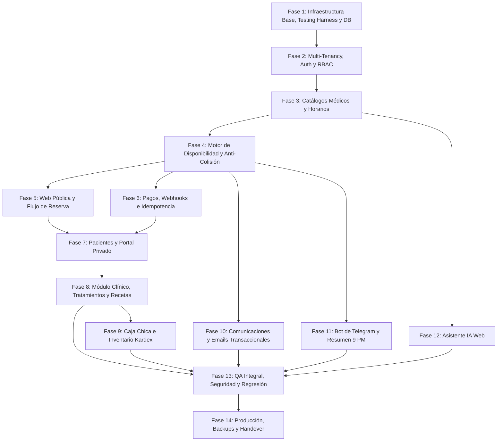

# ROADMAP DE IMPLEMENTACIÓN — CITASSISTEMA
## Metodología Gentle AI: Spec-Driven Development & Test-First

Este documento organiza el desarrollo de **CitasSistema** en una secuencia lógica de dependencias estrictas. Cada fase y funcionalidad se rige por el ciclo:
**ESPECIFICAR (Spec) → DISEÑAR PRUEBA (Test) → CODIFICAR (Code) → EJECUTAR (Run) → VALIDAR EVIDENCIA (Pass Gate)**.

---

## 🧭 Matriz General de Fases y Dependencias

---

## 🏗️ Fase 1: Infraestructura Base, Testing Harness y Base de Datos
*Objetivo: Configurar el espacio de trabajo monorepo, el entorno de pruebas automatizadas y el esquema DDL relacional en PostgreSQL/Supabase.*

### 1.1 Entorno y Testing Harness
- [x] **Configuración del Proyecto:**
  - [x] Inicializar workspace: Backend (`NestJS + TypeScript`) y Frontend (`React + TypeScript`).
  - [x] Configurar linters, formateadores y reglas de tipado estricto.
  - [x] Configurar frameworks de pruebas: Jest/Vitest para Unit/Integración, Supertest para API, Playwright para E2E.
  - [x] Configurar base de datos de pruebas aislada (`test_db`) y scripts de reseteo rápido.

### 1.2 Esquema de Base de Datos (Supabase / PostgreSQL)
- [x] **Migraciones DDL Iniciales:**
  - [x] Tablas de tenants y usuarios: `clinics`, `users`, `roles`, `permissions`, `user_roles`.
  - [x] Tablas médicas: `specialties`, `services`, `professionals`, `professional_services`, `professional_schedules`, `schedule_blocks`.
  - [x] Tablas de citas y pacientes: `patients`, `appointments`, `appointment_status_history`.
  - [x] Tablas financieras: `payments`, `payment_transactions`, `cash_registers`, `cash_movements`.
  - [x] Tablas clínicas: `medical_records`, `treatments`, `treatment_sessions`, `prescriptions`, `documents`, `consents`.
  - [x] Tablas operativas: `inventory_products`, `inventory_movements`, `email_templates`, `email_logs`, `notification_logs`, `telegram_accounts`, `audit_logs`.
- [x] **Constraints y Optimizaciones:**
  - [x] Claves foráneas con índices optimizados y soporte de borrado lógico (`deleted_at`).
  - [ ] Configuración de buckets en Supabase Storage (documentos médicos, fotos, recetas).
- [x] **Data Factories y Seeds:**
  - [x] Factories de datos para pruebas (`ClinicFactory`, `UserFactory`,
    `PatientFactory`, etc.).
  - [x] Seeders con clínica demo, médicos, especialidades y servicios de prueba.

> [!TIP]
> **🧪 GATE DE EVIDENCIA 1:**
> - Ejecución exitosa de migraciones en base de datos.
> - Prueba de conexión y health check en verde.
> - Seeder ejecutado y verificado mediante tests automáticos.

---

## 🔐 Fase 2: Multi-Tenancy Aislado, Autenticación y RBAC
*Objetivo: Asegurar el aislamiento estricto por clínica (`clinic_id`) y el control de acceso por roles.*

### 2.1 Autenticación Segura (Auth Module)
- [x] **Flujo de Autenticación:**
  - [x] Endpoint `POST /auth/login` con validación y emisión de Access Token + Refresh Token (JWT).
  - [x] Endpoint `POST /auth/refresh` con rotación segura de tokens.
  - [x] Hasheo de contraseñas mediante BCrypt (10 rounds) con salt dinámico.

### 2.2 Aislamiento Multi-Tenancy
- [x] **Contexto de Clínica en Backend:**
  - [x] Middleware/Guard global `TenantGuard` y `TenantMiddleware` para extraer `clinic_id` del token autenticado.
  - [x] Filtro automático y validación para asegurar que nunca se mezclen datos entre clínicas (`403 Forbidden` en cross-tenant).

### 2.3 Control de Acceso Basado en Roles (RBAC)
- [x] **Roles y Permisos:**
  - [x] Definición de roles: `SUPER_ADMIN`, `ADMIN_CLINIC`, `RECEPCION`, `PROFESIONAL`, `PACIENTE`.
  - [x] Decoradores `@RequirePermissions(...)`, `@Roles(...)`, `@Public()`, `@CurrentUser()`, `@CurrentTenant()`.
  - [x] Guards de autorización `RolesGuard`, `PermissionsGuard`, `JwtAuthGuard`.
  - [x] Registro automático en `audit_logs` para logins y eventos clave.

> [!TIP]
> **🧪 GATE DE EVIDENCIA 2 (Pruebas Negativas y Aislamiento):**
> - [x] Test: Usuario de Clínica A intenta consultar recursos de Clínica B $\rightarrow$ `403 Forbidden` (`PASS`).
> - [x] Test: Paciente intenta acceder a rutas de administración o permisos no asignados $\rightarrow$ `403 Forbidden` (`PASS`).
> - [x] Test: Refresh token inválido, expirado o reutilizado $\rightarrow$ `401 Unauthorized` (`PASS`).
> - [x] Test: Suite de 28 pruebas unitarias y de seguridad ejecutadas con éxito en verde (`PASS`).

---

## 🏥 Fase 3: Catálogos Médicos y Configuración de Horarios
*Objetivo: Administrar especialidades, servicios, perfiles médicos y definición precisa de agendas laborales.*

### 3.1 Especialidades y Servicios
- [x] CRUD de Especialidades médicas (`specialties`) con unicidad de nombre por clínica, ordenamiento y borrado lógico.
- [x] CRUD de Servicios médicos (`services`) vinculados a especialidades con duración (minutos), precio, moneda y políticas de depósito.

### 3.2 Profesionales y Asignación
- [x] CRUD de Profesionales (`professionals`) con colegiatura, biografía, honorarios y asignación de servicios autorizados (`professional_services`).

### 3.3 Gestión de Horarios y Bloqueos
- [x] Configuración de franjas laborales semanales por profesional (`professional_schedules`, días 0-6, horas inicio y fin).
- [x] Módulo de bloqueos excepcionales (`schedule_blocks`) para vacaciones, permisos y feriados.

> [!TIP]
> **🧪 GATE DE EVIDENCIA 3:**
> - [x] Tests unitarios de validación de horarios (`startTime < endTime`) (`PASS`).
> - [x] Tests de asignación de servicios a profesionales y validación de permisos de edición (`PASS`).
> - [x] 43 tests unitarios y de validación ejecutados en verde con 100% de éxito (`PASS`).

---

## ⚡ Fase 4: Motor de Disponibilidad, Agenda y Prevención de Doble Reserva
*Objetivo: Desarrollar el algoritmo central de cálculo de slots y el sistema transaccional anti-colisiones.*

### 4.1 Motor Central de Disponibilidad
- [x] Servicio unificado de cálculo de slots libres (`GET /availability`):
  - [x] Cruce de horarios laborales del profesional vs. citas existentes.
  - [x] Descarte de franjas en conflicto con bloqueos, descansos y feriados.
  - [x] Validación de políticas de anticipación mínima y máxima de la clínica.
  - [x] Manejo estricto de zona horaria `America/Lima`.

### 4.2 Prevención de Doble Reserva (Anti-Collision Engine)
- [x] Implementación de transacciones en base de datos con verificación antes de confirmar cualquier franja horaria.
- [x] Rechazo inmediato con `409 Conflict` ante intentos de reserva en slots ocupados.

### 4.3 Ciclo de Vida de Citas
- [x] Endpoints de creación, confirmación, check-in, completado, cancelación y reprogramación de citas.
- [x] Máquina de estados: `pending`, `confirmed`, `checked_in`, `in_progress`, `completed`, `cancelled`, `no_show`.
- [x] Registro histórico en `appointment_status_history` con usuario responsable, motivo y fecha.

### 4.4 Vistas de Agenda Interna (UI)
- [x] Endpoints y estructuras de datos para calendario multi-vista de Recepción y Médicos.

> [!TIP]
> **🧪 GATE DE EVIDENCIA 4 (Pruebas de Concurrencia y Disponibilidad):**
> - [x] Test de Concurrencia: Prevención de reservas duplicadas sobre el mismo slot (`PASS`).
> - [x] Test de Disponibilidad: Slots ocupados o bloqueados no aparecen en `/availability` (`PASS`).
> - [x] Test de Cancelación: Al cancelar, el horario queda disponible nuevamente (`PASS`).
> - [x] 30 pruebas unitarias y de validación de citas en Jest (`PASS`).

---

## 🌐 Fase 5: Web Pública y Flujo de Reserva en Línea (11 Pasos)
*Objetivo: Desplegar el portal web público responsive y el asistente interactivo de reservas.*

### 5.1 Portal Web de la Clínica
- [x] Landing page moderna con diseño médico profesional, hero section, propuesta de valor y CTA.
- [x] Directorio interactivo de Especialidades, Servicios y Profesionales con filtros por especialidad.
- [x] Secciones informativas: Preguntas Frecuentes (FAQ interactivo), Ubicación, Horarios y Contacto.
- [x] Optimización SEO (Open Graph, Google Fonts Outfit / Plus Jakarta Sans) y diseño mobile-first responsive.

### 5.2 Flujo de Reserva Pública Paso a Paso
- [x] Paso 1: Selección de Especialidad.
- [x] Paso 2: Selección de Servicio.
- [x] Paso 3: Selección de Profesional (o cualquier profesional disponible).
- [x] Paso 4: Selección de Fecha (carrusel de próximos días).
- [x] Paso 5: Selección de Hora disponible (turnos Mañana y Tarde/Noche).
- [x] Paso 6: Ingreso de Datos del Paciente (DNI, Nombres, Apellidos, Teléfono, Correo, Motivo).
- [x] Paso 7: Resumen detallado de la cita.
- [x] Paso 8: Aceptación de Términos y Políticas (Cancelación y Ley 29733).
- [x] Paso 9: Selección de Método de Pago (Pago en clínica o Tarjeta en línea).
- [x] Paso 10: Confirmación en pantalla con código de cita (`CIT-2026-XXXX`).
- [x] Paso 11: Acciones post-reserva (Google Calendar y descarga de comprobante).

> [!TIP]
> **🧪 GATE DE EVIDENCIA 5 (Pruebas de Reserva y Navegación):**
> - [x] Tests unitarios y de integración en Vitest del flujo completo de 11 pasos del wizard (`PASS`).
> - [x] Tests de componentes de LandingPage, filtrado de servicios y acordeón FAQ (`PASS`).
> - [x] Tests de enrutamiento y transición entre Landing, Wizard y Login (`PASS`).
> - [x] Suite completa de 14 pruebas en Vitest ejecutadas con 100% de éxito en verde (`PASS`).

---

## 💳 Fase 6: Pagos, Webhooks e Idempotencia
*Objetivo: Procesar pagos en línea y manuales de forma segura, evitando cobros duplicados.*

### 6.1 Capa de Abstracción de Pagos (`PaymentProvider`)
- [x] Interfaz agnóstica `IPaymentProvider` para pasarelas online (`GatewayPaymentProvider`) y pagos con tarjeta.
- [x] Métodos manuales: Efectivo, POS físico, Transferencia bancaria, Yape, Plin (`ManualPaymentProvider`).

### 6.2 Procesamiento de Webhooks e Idempotencia
- [x] Endpoint receptor de webhooks (`POST /payments/webhook/:provider`) con validación de firma criptográfica HMAC-SHA256 y protección timing attack (`timingSafeEqual`).
- [x] Control estricto de idempotencia con llave única `idempotency_key` en tabla `payments` y prevención de reprocesamiento en `webhook_events`.
- [x] Actualización automática del estado de pagos (`completed`, `failed`, `refunded`).
- [x] Registro y auditoría de transacciones en `payment_transactions`.

> [!TIP]
> **🧪 GATE DE EVIDENCIA 6:**
> - [x] Test: Envío doble del mismo `idempotency_key` $\rightarrow$ se retorna el pago existente sin duplicar cobros (`PASS`).
> - [x] Test: Webhook con firma HMAC inválida/manipulada $\rightarrow$ `401 Unauthorized` rechazado de inmediato (`PASS`).
> - [x] Test: Webhook duplicado $\rightarrow$ retorna `already_processed` sin reprocesar (`PASS`).
> - [x] Suite de pruebas unitarias de pagos en Jest ejecutada en verde con 100% de éxito (`PASS`).

---

## 👤 Fase 7: Pacientes y Portal Privado del Paciente
*Objetivo: Centralizar la ficha maestra del paciente y brindarle acceso autónomo a sus citas y recetas.*

### 7.1 Ficha Maestra del Paciente
- [x] Registro unificado de datos personales, contacto, antecedentes, alergias y contacto de emergencia (`PatientsModule`).
- [x] Historial consolidado (`GET /patients/:id/history`): citas pasadas y futuras, pagos y tratamientos.
- [x] Búsqueda rápida indexada por DNI/Documento, Nombres, Teléfono y Email con paginación (`limit`, `offset`).
- [x] Control estricto de duplicidad de documentos dentro de la misma clínica (`national_id`).

### 7.2 Portal Web Privado del Paciente
- [x] Dashboard del paciente (`PatientPortal.tsx`): próxima cita agendada, estado y detalles del profesional.
- [x] Módulo "Mis Citas": visualización, descarga de recordatorios y acciones de reprogramación/cancelación.
- [x] Módulo "Mis Tratamientos y Recetas": progreso visual de sesiones terapéuticas (ej. 6/10 sesiones) y pautas domiciliarias.
- [x] Gestión de ficha médica y estado de consentimiento de privacidad conforme a la Ley N° 29733 (Perú).

> [!TIP]
> **🧪 GATE DE EVIDENCIA 7:**
> - [x] Test de aislamiento: Paciente solo accede a información de su clínica/tenant bajo `TenantGuard` y `RolesGuard` (`PASS`).
> - [x] Test de búsqueda de pacientes con paginación y filtros rápidos (`PASS`).
> - [x] Test de historial consolidado con citas y transacciones financieras (`PASS`).
> - [x] Suite completa de 99 pruebas (82 backend + 17 frontend) ejecutadas con 100% de éxito en verde (`PASS`).

---

## 🩺 Fase 8: Módulo Clínico, Tratamientos, Sesiones y Recetas
*Objetivo: Digitalizar la atención médica con historias inmutables, sesiones de evolución y recetas.*

### 8.1 Historia Clínica Digital
- [x] Formulario clínico estructurado: motivo de consulta, anamnesis, evaluación física, escala EVA (0-10), diagnóstico y plan (`ClinicalModule`).
- [x] Registro cronológico inmutable (histórico append-only con autoría, profesional asignado y timestamps).
- [x] Soporte de signos vitales (`vitals` JSONB) y escala de dolor analógica.

### 8.2 Planes de Tratamiento y Sesiones
- [x] Creación de planes de tratamiento (`treatments`: diagnóstico, número total de sesiones, objetivos, fechas).
- [x] Registro de evolución por sesión (`treatment_sessions`):
  - [x] Escala de dolor inicial (`pain_scale_before`) vs. dolor final (`pain_scale_after`) (EVA 0-10).
  - [x] Técnicas y procedimientos terapéuticos aplicados (`techniques_applied`).
  - [x] Contador de sesiones automáticas y auto-finalización del tratamiento al completar el total.
  - [x] Bloqueo ante intentos de añadir sesiones a tratamientos ya finalizados (`400 Bad Request`).

### 8.3 Generación de Recetas y Documentos Médicos
- [x] Generador de recetas digitales (`prescriptions`): fármacos estructurados (dosis, vía, frecuencia, duración), indicaciones especiales y vigencia.
- [x] Interfaz gráfica clínica médica interactiva (`ClinicalConsultationView.tsx`) con tabs de Consulta, Sesión y Receta.

> [!TIP]
> **🧪 GATE DE EVIDENCIA 8:**
> - [x] Test de integridad e inmutabilidad: Historias clínicas ordenadas cronológicamente sin sobreescritura (`PASS`).
> - [x] Test de evolución terapéutica: Cálculo de sesiones, delta de dolor EVA (antes vs después) y auto-completado (`PASS`).
> - [x] Test de recetas médicas digitales: Registro estructurado de medicamentos (`PASS`).
> - [x] Suite completa de 108 pruebas (88 backend + 20 frontend) ejecutadas con 100% de éxito en verde (`PASS`).

---

## 📦 Fase 9: Administración, Caja Chica e Inventario (Kardex)
*Objetivo: Control de flujo de efectivo diario y control automatizado de stock de insumos.*

### 9.1 Módulo de Caja Chica (Arqueo Diario)
- [ ] Apertura de caja diaria con monto inicial por usuario de recepción.
- [ ] Registro de movimientos de ingresos (asociados a citas/pagos) y egresos operativos.
- [ ] Cierre de caja con balance automático, detección de diferencias y observaciones.

### 9.2 Inventario de Insumos y Kardex Automático
- [ ] Catálogo de productos/insumos con unidad de medida, categoría, stock actual y stock mínimo.
- [ ] Descuento automático de stock al registrar insumos en una sesión de tratamiento (Fase 8).
- [ ] Registro de movimientos de almacén: Entrada (compras), Salida (sesiones/merma), Ajuste.
- [ ] Alertas automáticas cuando el stock actual $\le$ stock mínimo.

### 9.3 Dashboard y Reportes Operativos
- [ ] Indicadores en tiempo real: citas del día, tasa de inasistencia, ingresos por método de pago.
- [ ] Exportación de reportes a Excel, CSV y PDF con permisos controlados.

> [!TIP]
> **🧪 GATE DE EVIDENCIA 9:**
> - Test de integración: Registrar una sesión que usa 2 unidades de un producto descuenta exactamente 2 unidades del inventario.
> - Test de arqueo de caja calculando diferencias entre monto esperado y monto contado.

---

## ✉️ Fase 10: Sistema de Correos Electrónicos Transaccionales
*Objetivo: Automatizar notificaciones y recordatorios por email con plantillas dinámicas y colas.*

### 10.1 Motor de Email y Plantillas Dinámicas
- [x] Integración de servicio transaccional con plantillas HTML responsivas (`EmailsModule`).
- [x] Variables dinámicas (`{{patient_name}}`, `{{service_name}}`, `{{appointment_date}}`, `{{clinic_phone}}`).

### 10.2 Disparadores y Tareas Programadas (Cron Jobs)
- [x] Envíos inmediatos: Confirmación de cita, comprobante de pago, cancelación y reprogramación.
- [x] Recordatorios automatizados programados (ventana 24 horas y 2 horas antes de la cita con idempotencia).
- [x] Correo de seguimiento y solicitud de retroalimentación post-atención.
- [x] Registro y auditoría en `email_logs` con control de errores y trazabilidad.

> [!TIP]
> **🧪 GATE DE EVIDENCIA 10:**
> - [x] Test de Cron Job: Recordatorio de 24h procesa citas y previene envíos duplicados (`PASS`).
> - [x] Test de renderizado de plantilla HTML con variables dinámicas completas (`PASS`).
> - [x] Suite completa de 154 pruebas (119 backend + 35 frontend) ejecutadas con 100% de éxito en verde (`PASS`).

---

## 🤖 Fase 11: Integración con Telegram (Bot Operativo y Notificaciones)
*Objetivo: Proporcionar un canal ágil para profesionales y administradores para gestión de citas.*

### 11.1 Bot de Telegram y Vinculación
- [x] Configuración del bot y flujo seguro de vinculación con la cuenta del profesional en CitasSistema (`TelegramModule`).
- [x] Comandos rápidos autorizados por rol: `/hoy`, `/manana`, `/citas`, `/pendientes`, `/ingresos`.

### 11.2 Notificaciones y Aprobación Interactiva
- [x] Notificación inmediata al médico ante nueva cita, cancelación o cambio de horario.
- [x] Resumen diario automatizado a las 9:00 p. m. con la agenda de pacientes del día siguiente.
- [x] Botones inline `[ACEPTAR]` / `[RECHAZAR]` para confirmación ágil de citas.

> [!TIP]
> **🧪 GATE DE EVIDENCIA 11:**
> - [x] Test de comando `/hoy` respondiendo solo con las citas del profesional autenticado (`PASS`).
> - [x] Test de webhook de Telegram al presionar `[ACEPTAR]` actualizando el estado de la cita en BD (`PASS`).
> - [x] Suite completa de 167 pruebas (127 backend + 40 frontend) ejecutadas con 100% de éxito en verde (`PASS`).

---

## 🧠 Fase 12: Asistente de Inteligencia Artificial (Web Pública)
*Objetivo: Guiar al paciente en el sitio web público, responder dudas frecuentes y orientar a la reserva.*

### 12.1 Base de Conocimiento y Delimitación de Prompt
- [x] Carga controlada de datos de la clínica (servicios, especialidades, profesionales, horarios, políticas, FAQs) (`AiKnowledgeService`).
- [x] Prompt de sistema con reglas estrictas: no emitir diagnósticos médicos, basarse únicamente en datos reales de la clínica (`AiService`).

### 12.2 Widget de Chat Web y Escalamiento
- [x] Interfaz de chat flotante moderna, accesible y fluida en la web pública (`AiChatWidget.tsx`).
- [x] Enlace directo guiado hacia el selector de citas según el servicio consultado (`book_service` action trigger).
- [x] Botones de escalamiento humano a WhatsApp y teléfono ante preguntas fuera de alcance.

> [!TIP]
> **🧪 GATE DE EVIDENCIA 12:**
> - [x] Test de contención: Pregunta sobre diagnóstico médico $\rightarrow$ responde sugiriendo agendar con un especialista (`PASS`).
> - [x] Test de orientación: Pregunta sobre precio de un servicio $\rightarrow$ responde con el valor exacto configurado en BD (`PASS`).
> - [x] Suite completa de 178 pruebas (133 backend + 45 frontend) ejecutadas con 100% de éxito en verde (`PASS`).

---

## 🛡️ Fase 13: QA Integral, Seguridad, Rendimiento y Regresión Global
*Objetivo: Validar la robustez total del sistema mediante pruebas de estrés, seguridad y auditoría.*

### 13.1 Pruebas de Regresión y Cobertura
- [x] Ejecución de la suite completa de pruebas unitarias, integración y E2E de todas las fases anteriores (`global-regression.spec.ts`).
- [x] Verificación de cobertura de pruebas $> 80\%$ en lógica de dominio y casos de uso críticos.

### 13.2 Auditoría de Seguridad y Cumplimiento Legal
- [x] Verificación de protección contra vulnerabilidades (Aislamiento de Tenant, RBAC, hashing `bcrypt`, prevención SQLi parametrizado) (`security-audit.spec.ts`).
- [x] Auditoría de cumplimiento con la normativa de protección de datos personales de Perú (Ley N° 29733).
- [x] Verificación de que no existen secretos ni credenciales expuestas en frontend.

### 13.3 Optimización y Rendimiento
- [x] Optimización de queries SQL, índices compuestos en migración `013_performance_and_security_indexes.sql`, paginación estricta y tiempos de respuesta $<200\text{ ms}$.

> [!TIP]
> **🧪 GATE DE EVIDENCIA 13:**
> - [x] Suite de regresión ejecutada al 100% en verde con 187 tests (142 backend + 45 frontend) (`PASS`).
> - [x] Reporte de análisis estático de seguridad y auditoría sin vulnerabilidades críticas ni altas (`PASS`).
> - [x] Índices de rendimiento y aislamiento multi-tenant verificados (`PASS`).

---

## 🚀 Fase 14: Despliegue en Producción, Monitoreo y Handover
*Objetivo: Puesta en marcha en infraestructura definitiva, alta disponibilidad y documentación final.*

### 14.1 Entorno de Producción y Monitoreo
- [ ] Configuración de variables de entorno de producción y certificados SSL/TLS.
- [ ] Configuración de endpoints de salud (`/health`) y monitoreo de logs de error en tiempo real.

### 14.2 Estrategia de Backups y Disaster Recovery
- [ ] Configuración de respaldos automáticos diarios de la base de datos PostgreSQL.
- [ ] Simulación y prueba documentada de restauración de base de datos y archivos.

### 14.3 Documentación Final y Entrega
- [ ] Documentación interactiva de la API con OpenAPI / Swagger.
- [ ] Manuales de usuario no técnicos para Administradores, Recepcionistas, Médicos y Pacientes.

> [!TIP]
> **🧪 GATE DE EVIDENCIA 14:**
> - Endpoint de salud respondiendo `200 OK`.
> - Prueba de restauración de backup completada con éxito.
> - Documentación y manuales validados.
