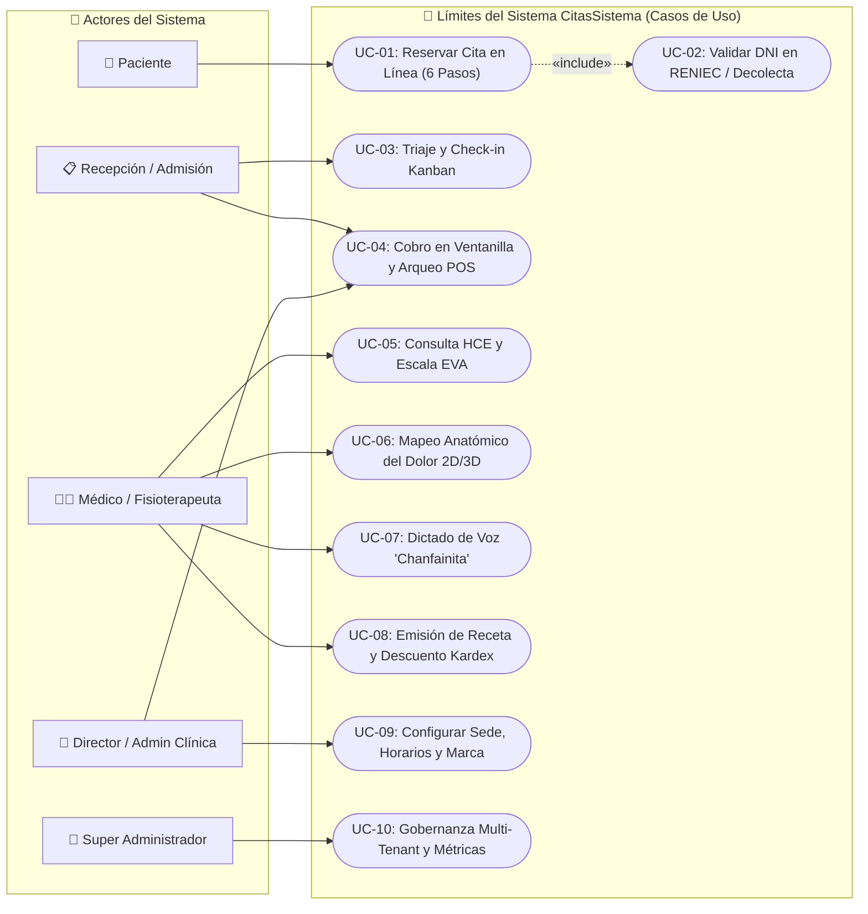
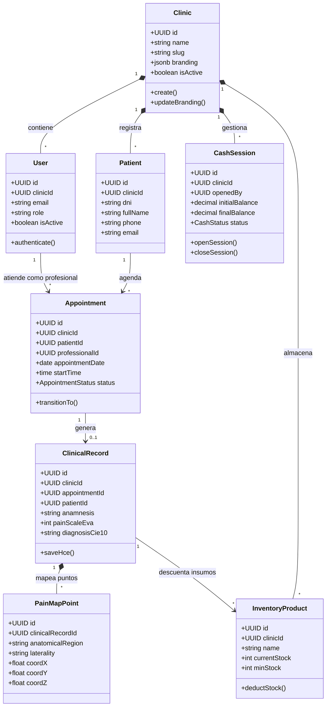
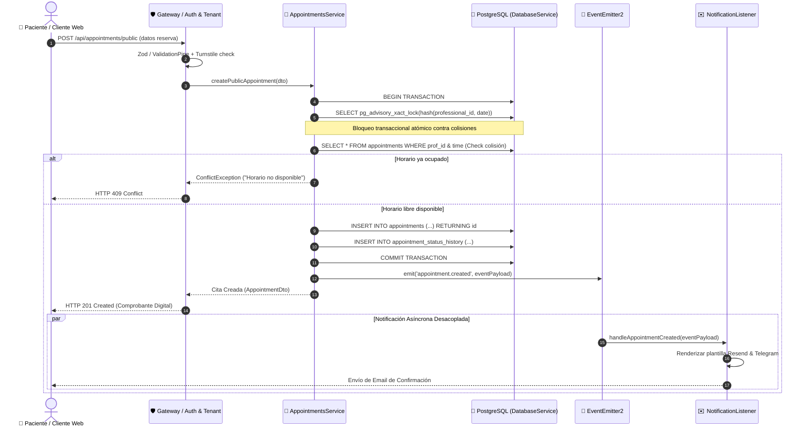
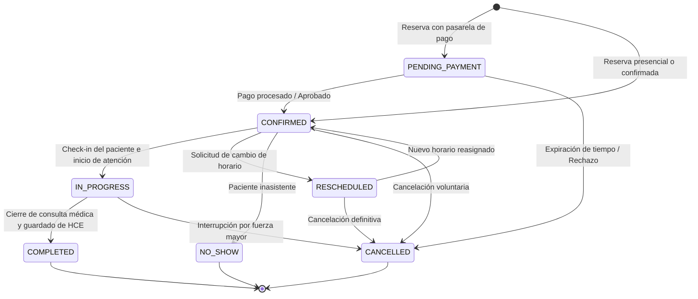
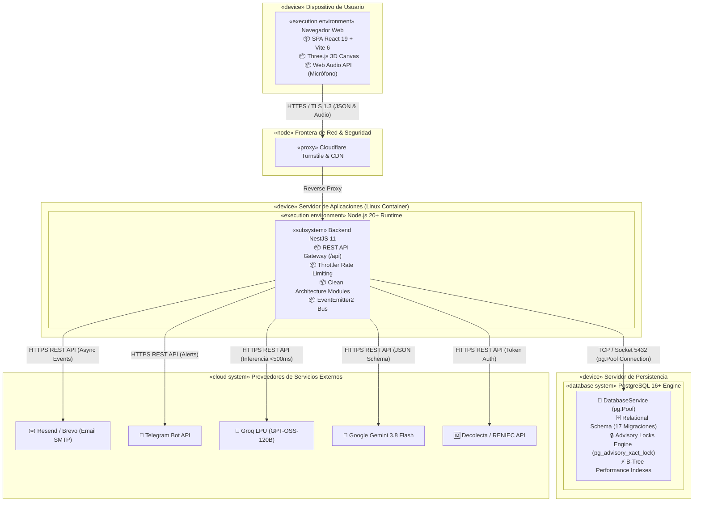
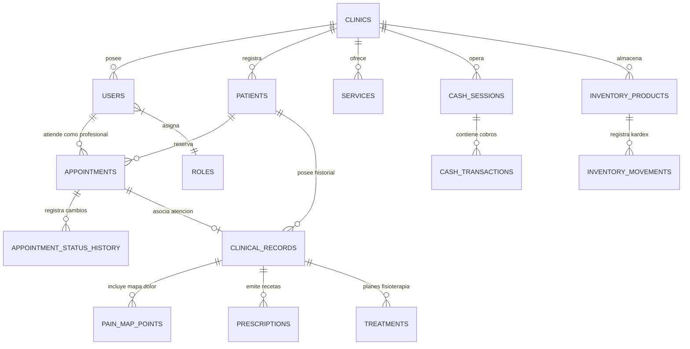
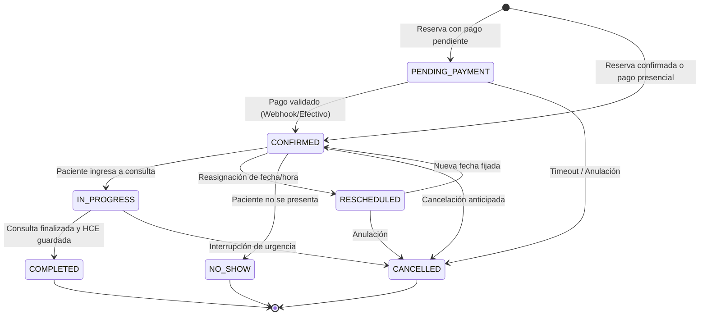
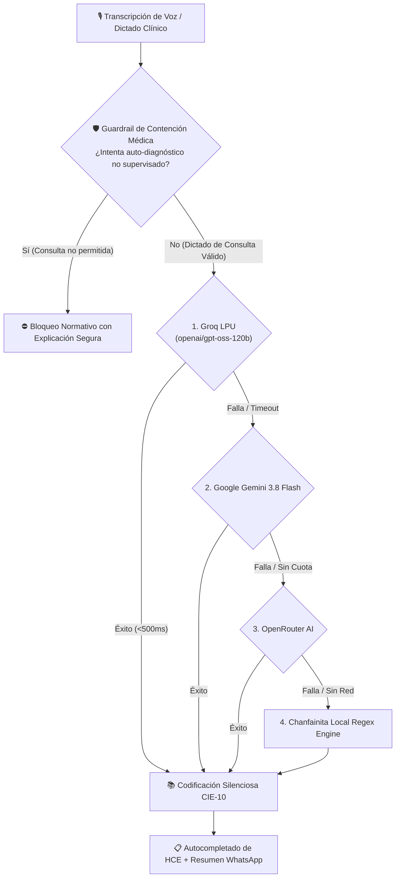

# 🏛️ Arquitectura del Sistema — CitasSistema

> **Documento de Especificación Arquitectónica y Diseño Técnico**  
> _Versión 1.1 — Monolito Modular, Multi-Tenant y Event-Driven con Metodología RUP y Modelado UML (Modelo 4+1 Vistas)_

---

## 📑 Tabla de Contenidos

- [1. Visión General y Filosofía de Diseño](#1-visión-general-y-filosofía-de-diseño)
- [2. Metodología RUP y Modelo de Vistas 4+1 UML](#2-metodología-rup-y-modelo-de-vistas-41-uml)
  - [2.1 Vista de Casos de Uso (Use Case View)](#21-vista-de-casos-de-uso-use-case-view)
  - [2.2 Vista Lógica (Logical View - Diagrama de Clases UML)](#22-vista-lógica-logical-view---diagrama-de-clases-uml)
  - [2.3 Vista de Procesos (Process View - Diagrama de Secuencia UML)](#23-vista-de-procesos-process-view---diagrama-de-secuencia-uml)
  - [2.4 Vista Dinámica (Statechart - Diagrama de Estados FSM)](#24-vista-dinámica-statechart---diagrama-de-estados-fsm)
  - [2.5 Vista de Implementación y Despliegue (Deployment & Component View)](#25-vista-de-implementación-y-despliegue-deployment--component-view)
  - [2.6 Fases y Disciplinas del Proceso RUP](#26-fases-y-disciplinas-del-proceso-rup)
- [3. Estructura del Monorepo](#3-estructura-del-monorepo)
- [4. Capa Frontend (Client-Side SPA)](#4-capa-frontend-client-side-spa)
- [5. Capa Backend (Core API & Clean Architecture)](#5-capa-backend-core-api--clean-architecture)
- [6. Modelo de Datos y Persistencia Relacional](#6-modelo-de-datos-y-persistencia-relacional)
- [7. Máquinas de Estado Finitas (FSM) y Concurrencia](#7-máquinas-de-estado-finitas-fsm-y-concurrencia)
- [8. Seguridad y Multi-Tenancy (Anti-IDOR)](#8-seguridad-y-multi-tenancy-anti-idor)
- [9. Integración de Inteligencia Artificial (Chanfainita Voice Engine)](#9-integración-de-inteligencia-artificial-chanfainita-voice-engine)
- [10. Decisiones Arquitectónicas Registradas (ADRs)](#10-decisiones-arquitectónicas-registradas-adrs)

---

## 1. Visión General y Filosofía de Diseño

**CitasSistema** está diseñado como un **Monolito Modular de Alto Rendimiento** que combina la simplicidad de despliegue y desarrollo de un monorepo con el desacoplamiento lógico propio de arquitecturas orientadas al dominio (DDD) y sistemas guiados por eventos (Event-Driven Architecture).

### Principios Fundamentales

1. **Multi-Tenancy Nativo por Registro:** Cada tabla operativa cuenta con `clinic_id`, gobernada por el `TenantGuard` y validaciones estrictas de titularidad de datos (`assertPatientOwnership`).
2. **Cero Sobrereservas (Zero Double-Booking):** El motor transaccional de citas utiliza bloqueos consultivos a nivel de base de datos (`pg_advisory_xact_lock`) sobre el profesional y la fecha/bloque horario.
3. **Seguridad Anti-XSS (Gold Standard):** El `access_token` JWT reside exclusivamente en la memoria volátil de React (`AuthContext`), mientras que el `refresh_token` se transporta en una Cookie HTTP `HttpOnly; Secure; SameSite=Lax`.
4. **Desacoplamiento Asíncrono de Efectos Secundarios:** Los eventos de confirmación, cancelación o reasignación disparan notificaciones (email Resend/Brevo, Telegram) mediante `@nestjs/event-emitter` fuera del ciclo transaccional HTTP.
5. **Fail-Fast Environment:** Todas las variables de configuración se validan al inicio mediante esquemas estrictos de `Zod`, abortando el arranque si falta alguna credencial crítica o formato inválido.

---

## 2. Metodología RUP y Modelo de Vistas 4+1 UML

El modelado y documentación arquitectónica sigue las mejores prácticas de la metodología **RUP (Rational Unified Process)**, organizándose mediante el **Modelo de Vistas 4+1 de Philippe Kruchten**, donde los Casos de Uso actúan como elemento integrador de las cuatro vistas técnicas (Lógica, Procesos, Implementación y Despliegue):

```text
       ┌────────────────────────┐
       │  Vista de Casos de Uso │ (Comportamiento y Negocio)
       └───────────┬────────────┘
                   │
    ┌──────────────┼──────────────┐
    │              │              │
┌───┴──────────┐   │   ┌──────────┴───┐
│ Vista Lógica │   │   │  Vista de    │
│ (Clases UML) │   │   │  Procesos    │
└──────────────┘   │   │  (Secuencia) │
                   │   └──────────────┘
    ┌──────────────┼──────────────┐
    │              │              │
┌───┴──────────┐   │   ┌──────────┴───┐
│ Vista de     │   │   │  Vista de    │
│ Componentes  │   │   │  Despliegue  │
└──────────────┘   │   └──────────────┘
                   │
       ┌───────────┴────────────┐
       │ Fases RUP e Iteración  │
       └────────────────────────┘
```

### 2.1 Vista de Casos de Uso (Use Case View)

Identifica a los actores que interactúan con el sistema y sus respectivos casos de uso esenciales:



---

### 2.2 Vista Lógica (Logical View - Diagrama de Clases UML)

Describe la estructura estática del modelo de dominio clínico, finanzas y control de inventario:



---

### 2.3 Vista de Procesos (Process View - Diagrama de Secuencia UML)

Ilustra la dinámica de ejecución concurrente durante la reserva atómica con bloqueo consultivo en PostgreSQL:



---

### 2.4 Vista Dinámica (Statechart - Diagrama de Estados FSM)

Modela los estados de vida de una cita y las transiciones válidas:



---

### 2.5 Vista de Implementación y Despliegue (Deployment & Component View)

Mapea la distribución física en contenedores y servicios en la nube:



---

### 2.6 Fases y Disciplinas del Proceso RUP

| Fase RUP                           | Objetivo Primario                                                                                                                                 | Entregables y Artefactos Producidos                                                                      | Hito RUP Alcanzado                                   |
| :--------------------------------- | :------------------------------------------------------------------------------------------------------------------------------------------------ | :------------------------------------------------------------------------------------------------------- | :--------------------------------------------------- |
| **1. Inicio (Inception)**          | Definición del alcance del SaaS, viabilidad técnica, captura de requerimientos de clínicas y arquitectura monolítica modular.                     | Casos de uso base, modelo de dominio conceptual, prototipo de asistente de voz.                          | **LCO** (_Lifecycle Objectives Milestone_)           |
| **2. Elaboración (Elaboration)**   | Mitigación de riesgos críticos de concurrencia y seguridad: Advisory Locks en PostgreSQL, autenticación anti-XSS y validación Fail-Fast Zod.      | Arquitectura ejecutable 4+1, paquete `@citassistema/shared-types`, esquemas DDL (001-008).               | **LCA** (_Lifecycle Architecture Milestone_)         |
| **3. Construcción (Construction)** | Desarrollo iterativo de los 16 módulos de dominio NestJS, visor Three.js 3D, FSM de caja y citas, e inferencia LLM en cascada.                    | 17 migraciones completas, 409 pruebas automáticas aprobadas, integración con Telegram/Resend.            | **IOC** (_Initial Operational Capability Milestone_) |
| **4. Transición (Transition)**     | Auditorías de seguridad de secretos, optimización de bundles Vite (`< 500 kB`), smoke tests en navegador real con Puppeteer y empaquetado Docker. | Versión `0.1.0-alpha` lista para producción, suite E2E superada al 100%, documentación técnica completa. | **PR** (_Product Release Milestone_)                 |

---

## 3. Estructura del Monorepo

El proyecto está orquestado mediante npm workspaces:

```text
SistemaCitas_ok/
├── apps/
│   ├── backend/                      # API REST construida con NestJS 11 y TypeScript 5.7
│   │   ├── src/
│   │   │   ├── common/               # Guards, interceptores, filtros y utilidades de seguridad
│   │   │   ├── config/               # Configuración centralizada y esquema Zod de entorno
│   │   │   ├── database/             # Servicio pg.Pool, runner de migraciones y semillas
│   │   │   └── modules/              # 16 módulos de dominio con responsabilidades aisladas
│   │   └── test/                     # Suites de tests Jest (unitarios) y E2E (PostgreSQL real)
│   └── frontend/                     # SPA en React 19, Vite 6 y Tailwind CSS 4
│       ├── src/
│       │   ├── components/           # Componentes UI reutilizables (Kanban, PainMap, Modales)
│       │   ├── context/              # Contextos globales (AuthContext en memoria, Theme, Tenant)
│       │   ├── pages/                # Vistas principales y dashboards específicos por rol
│       │   ├── services/             # Adaptadores HTTP hacia el backend
│       │   └── utils/                # Utilidades de almacenamiento seguro, helpers de audio y fecha
│       └── vite.config.ts            # Optimización de chunks y proxy reverso local
├── packages/
│   └── shared-types/                 # Contratos TypeScript comunes, enums de FSM y parseadores
├── db/
│   ├── docker/docker-compose.yml     # Orquestación de contenedores PostgreSQL (dev y test)
│   ├── migrations/                   # 17 archivos SQL DDL versionados secuencialmente
│   └── seeds/                        # Scripts SQL con catálogos médicos y datos de demostración
└── docs/                             # Documentación de diseño, reglas de negocio y ADRs
```

---

## 4. Capa Frontend (Client-Side SPA)

- **Framework:** React 19 con renderizado en el cliente mediante Vite 6.
- **Estilos:** Tailwind CSS 4 con sistema de tokens de diseño dinámicos para soporte de marca blanca (white-labeling).
- **Gestión de Estado y Sesión:**
  - `AuthContext`: Conserva el `accessToken`, datos del usuario autenticado y permisos en memoria de ejecución.
  - Implementación de **Silent Refresh**: Al cargar la página (`F5`), un `useEffect` invoca `/api/auth/refresh-token` enviando automáticamente la cookie segura. Si es válida, el estado se hidrata sin requerir credenciales en almacenamiento local (`localStorage`).
- **Visualización 3D:** Integración con `Three.js` cargada de forma dinámica para renderizar el modelo corporal del mapa del dolor (PainMap 3D), optimizando el tiempo de carga inicial.
- **División de Código (Code Splitting):** Configuración en Vite con `manualChunks` que separa dependencias pesadas (`three`, `lucide-react`, `vendor`) manteniendo el bundle principal bajo 500 kB.

---

## 5. Capa Backend (Core API & Clean Architecture)

El backend expone una API REST modular construida sobre NestJS 11:

1. **ValidationPipe Global:** Transforma payloads y aplica validación estricta descartando propiedades no reconocidas (`whitelist: true`).
2. **HttpExceptionFilter Global:** Captura cualquier excepción de la aplicación. En caso de colisiones de base de datos (PostgreSQL `23505` clave única o `23503` llave foránea), sanitiza el mensaje para no filtrar información estructural del esquema relacional.
3. **ThrottlerGuard:** Limita ráfagas de solicitudes en endpoints públicos sensibles (login, consulta por DNI, reserva pública).
4. **Módulos de Dominio:**
   - `AuthModule`: Generación y rotación de tokens JWT (Access de 15m / Refresh de 7d con almacenamiento de hash en base de datos).
   - `AppointmentsModule`: Motor de disponibilidad horaria y transición de estados con FSM.
   - `ClinicalModule`: Historias clínicas, recetas, puntos de mapa de dolor anatómico y sesiones de tratamiento.
   - `ClinicalVoiceAssistantService`: Asistente bilateral con cascada de inferencia y guardrails de seguridad clínica.
   - `CashModule` e `InventoryModule`: Control de arqueo de caja chica y Kardex de inventario.

---

## 6. Modelo de Datos y Persistencia Relacional

El almacenamiento persiste en **PostgreSQL 16+** administrado a través de `DatabaseService` utilizando un pool nativo (`pg.Pool`) optimizado para transacciones concurrentes ACID:



---

## 7. Máquinas de Estado Finitas (FSM) y Concurrencia

### Ciclo de Vida de las Citas (`AppointmentStatus`)

El cambio de estado de una cita está restringido por la función de transición estricta `canTransitionAppointment`:



### Prevención Atómica de Sobrereservas

Durante el proceso de reserva, el sistema adquiere un bloqueo consultivo transaccional en PostgreSQL:

```sql
SELECT pg_advisory_xact_lock(hashtext(concat('appt_', professional_id::text, '_', appointment_date::text)));
```

Este bloqueo garantiza que dos solicitudes simultáneas para el mismo profesional y bloque horario se procesen secuencialmente, abortando la segunda transacción si el intervalo ya fue ocupado.

---

## 8. Seguridad y Multi-Tenancy (Anti-IDOR)

1. **Aislamiento de Inquilinos (`TenantGuard`):**  
   Cada solicitud autenticada extrae el contexto del `clinic_id` desde el token o encabezado autorizado. Las consultas SQL parametrizadas inyectan obligatoriamente la cláusula `WHERE clinic_id = $1`.
2. **Defensa Anti-IDOR (`assertPatientOwnership`):**  
   Antes de permitir la lectura o modificación de una historia clínica o cita, el backend ejecuta una verificación cruzada para validar que el paciente pertenezca a la clínica del operador o que el usuario solicitante sea el propio paciente autenticado.
3. **Rotación de Refresh Tokens:**  
   Los tokens de actualización se almacenan con cifrado hash seguro en base de datos (`auth_refresh_tokens`). Si un token ya revocado intenta ser reutilizado, la sesión se invalida por completo como medida preventiva.

---

## 9. Integración de Inteligencia Artificial (Chanfainita Voice Engine)

El módulo clínico cuenta con un motor de asistencia de voz para profesionales de la salud con una estrategia de cascada tolerante a fallos:



---

## 10. Decisiones Arquitectónicas Registradas (ADRs)

Para conocer en detalle el contexto, alternativas evaluadas y consecuencias de las decisiones tomadas durante el desarrollo:

- [ADR 001: Decisiones de Arquitectura y Seguridad](./adr/001-architecture-and-security-decisions.md) — Adopción de tokens en memoria volátil, cookies HttpOnly y Advisory Locks para citas.
- [ADR 002: Dominio Tipado y Validación Fail-Fast](./adr/002-typed-domain-and-fail-fast-env.md) — Definición de esquemas Zod en backend y paquete de tipos compartidos `@citassistema/shared-types`.
