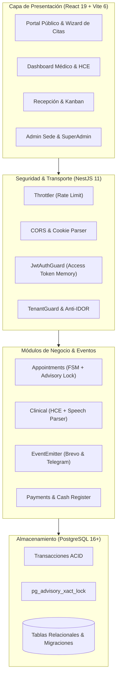

# Arquitectura del Sistema — CitasSistema

Documento de referencia arquitectónica para la plataforma SaaS multi-tenant CitasSistema.

---

## 1. Visión Arquitectónica General

CitasSistema está construido bajo el patrón de **Monolito Modular con Clean Architecture pragmática** en el backend (`apps/backend`) y una **Single Page Application (SPA) modular** en el frontend (`apps/frontend`), coordinados por un paquete compartido de tipos y lógica determinista de dominio (`packages/shared-types`).

---

## 2. Decisiones Clave de Diseño

1. **Aislamiento Multi-Tenant**: Cada consulta SQL incluye el contexto del `clinic_id` validado en cabecera o token JWT.
2. **Control de Concurrencia**: Serialización a nivel de PostgreSQL con `pg_advisory_xact_lock` por profesional y fecha.
3. **Máquinas de Estado Finitas (FSM)**: Transiciones formales en `@citassistema/shared-types` que impiden saltos inválidos en citas y caja.
4. **Desacoplamiento por Eventos**: Uso de `@nestjs/event-emitter` para delegar notificaciones a Brevo y Telegram sin retrasar la respuesta HTTP.
5. **Defensa en Profundidad Anti-XSS**: Access Token en memoria volátil de React y Refresh Token en cookie `HttpOnly; SameSite=Lax`.
