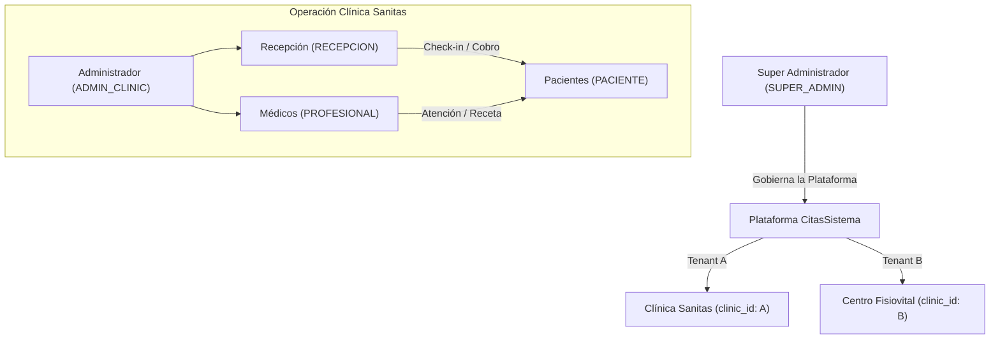
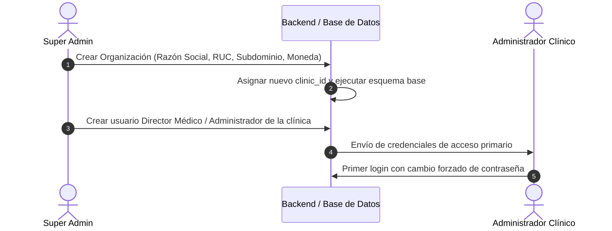
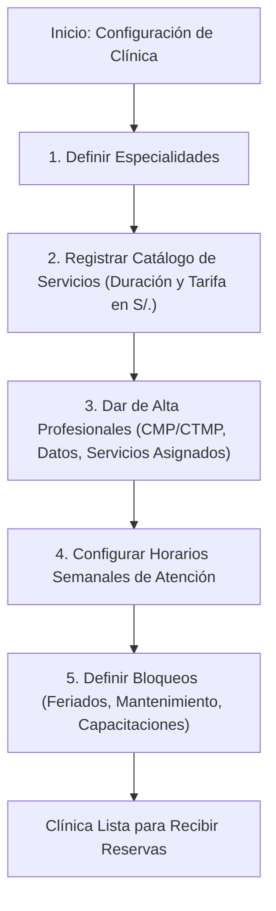
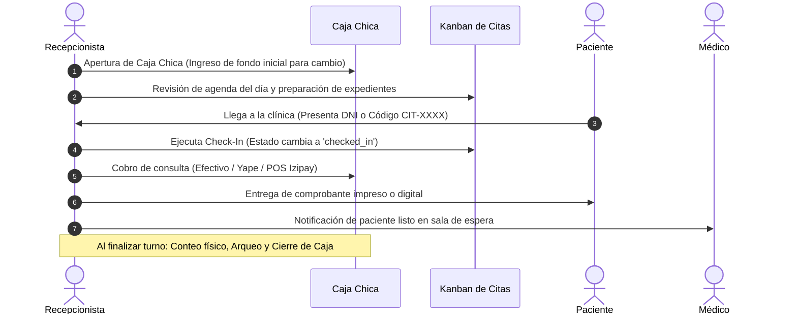
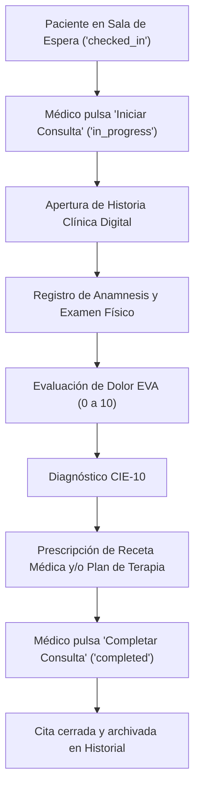
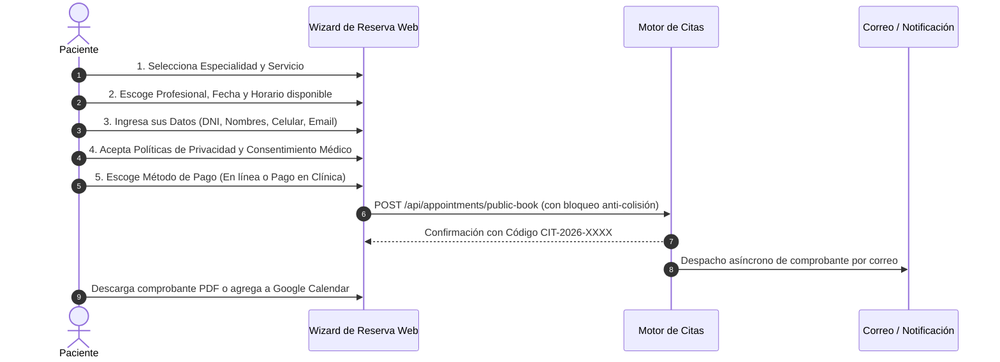
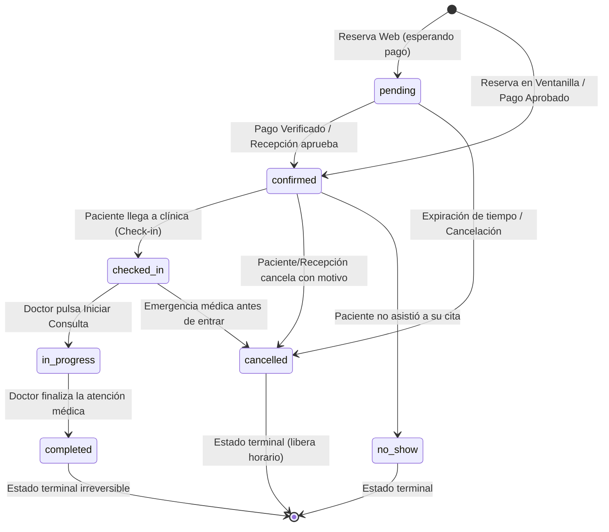
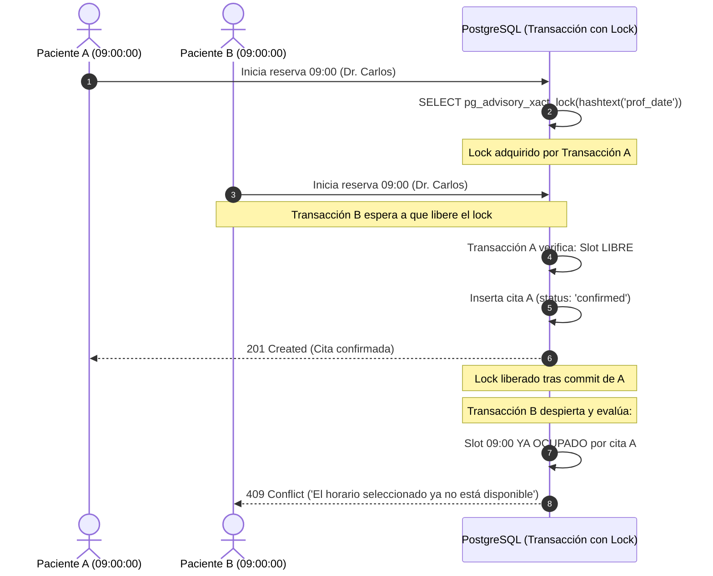
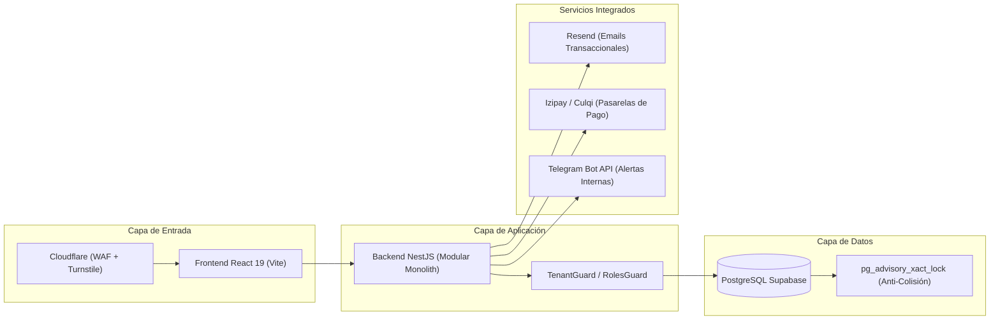

# CITASSISTEMA — MANUAL DE FLUJOS OPERACIONALES POR ROL Y REGLAS DE NEGOCIO

**Documento Oficial de Especificación Operativa y Lógica de Negocio**  
**Versión:** 1.0.0 — Producción  
**Ámbito:** Arquitectura Multi-Tenant de Salud (Clínicas, Centros de Fisioterapia y Consultorios Médicos)  
**Zona Horaria Oficial:** `America/Lima` (UTC-5)  
**Moneda Oficial:** Soles Peruanos (`S/.` / `PEN`)

---

## TABLA DE CONTENIDOS

1. [Visión General del Sistema y Arquitectura de Roles](#1-visión-general-del-sistema-y-arquitectura-de-roles)
2. [Matriz de Permisos y Control de Acceso (RBAC)](#2-matriz-de-permisos-y-control-de-acceso-rbac)
3. [Flujos Operacionales Detallados por Rol](#3-flujos-operacionales-detallados-por-rol)
   - 3.1. [Rol: Super Administrador (SUPER_ADMIN)](#31-rol-super-administrador-super_admin)
   - 3.2. [Rol: Administrador de Clínica (ADMIN_CLINIC)](#32-rol-administrador-de-clínica-admin_clinic)
   - 3.3. [Rol: Recepción y Admisión (RECEPCION)](#33-rol-recepción-y-admisión-recepcion)
   - 3.4. [Rol: Profesional de Salud / Médico / Fisioterapeuta (PROFESIONAL)](#34-rol-profesional-de-salud--médico--fisioterapeuta-profesional)
   - 3.5. [Rol: Paciente / Usuario Final (PACIENTE)](#35-rol-paciente--usuario-final-paciente)
4. [Ciclo de Vida de la Cita Médica (State Machine)](#4-ciclo-de-vida-de-la-cita-médica-state-machine)
5. [Motor Anti-Colisión y Cálculo de Disponibilidad](#5-motor-anti-colisión-y-cálculo-de-disponibilidad)
6. [Reglas de Negocio Generales por Dominio](#6-reglas-de-negocio-generales-por-dominio)
   - 6.1. [Agendamiento y Reservas](#61-agendamiento-y-reservas)
   - 6.2. [Financiero, Caja Chica y Pasarelas de Pago](#62-financiero-caja-chica-y-pasarelas-de-pago)
   - 6.3. [Historias Clínicas, Sesiones y Recetas](#63-historias-clínicas-sesiones-y-recetas)
   - 6.4. [Inventario de Insumos y Kardex](#64-inventario-de-insumos-y-kardex)
   - 6.5. [Comunicaciones, Recordatorios y Notificaciones](#65-comunicaciones-recordatorios-y-notificaciones)
   - 6.6. [Seguridad, Multi-Tenancy y Protección de Datos](#66-seguridad-multi-tenancy-y-protección-de-datos)

---

## 1. VISIÓN GENERAL DEL SISTEMA Y ARQUITECTURA DE ROLES

CitasSistema es una plataforma médica modular diseñada bajo el principio de **Aislamiento Multi-Tenant Estricto**. Cada organización médica (clínica o consultorio) opera en su propio espacio lógico delimitado por un identificador único (`clinic_id`), compartiendo infraestructura pero manteniendo sus datos (pacientes, historias clínicas, facturación y catálogos) completamente inaccesibles para otras organizaciones.

---

## 2. MATRIZ DE PERMISOS Y CONTROL DE ACCESO (RBAC)

El acceso a las rutas API y vistas de frontend está regulado por `RolesGuard`, `PermissionsGuard` y `TenantGuard`.

| Capacidad Operativa | SUPER_ADMIN | ADMIN_CLINIC | RECEPCION | PROFESIONAL | PACIENTE | PÚBLICO |
|---|:---:|:---:|:---:|:---:|:---:|:---:|
| Ver / Crear Clínicas (Tenants) | SI | NO | NO | NO | NO | NO |
| Configuración de la Clínica y Sedes | SI | SI | NO | NO | NO | NO |
| Gestionar Especialidades y Servicios | SI | SI | NO | NO | NO | NO |
| Gestionar Personal (Doctores, Recepción) | SI | SI | NO | NO | NO | NO |
| Configurar Horarios y Bloqueos de Agenda | SI | SI | NO | LECTURA | NO | NO |
| Ver Agenda General / Kanban de Citas | SI | SI | SI | PROPIA | NO | NO |
| Agendar Cita Presencial / Telefónica | SI | SI | SI | NO | NO | NO |
| Reservar Cita Online (Público / Portal) | SI | SI | SI | NO | SI | SI |
| Realizar Check-in del Paciente | SI | SI | SI | NO | NO | NO |
| Iniciar y Finalizar Consulta Médica | NO | SI | NO | SI | NO | NO |
| Ver / Editar Historias Clínicas (EHR) | NO | SI | NO | SI | NO | NO |
| Emitir Recetas y Planes de Tratamiento | NO | SI | NO | SI | NO | NO |
| Apertura, Movimientos y Cierre de Caja | SI | SI | SI | NO | NO | NO |
| Reportes Financieros Consolidados | SI | SI | NO | NO | NO | NO |
| Control de Kardex / Insumos Médicos | SI | SI | SI | NO | NO | NO |
| Soft-Delete de Citas y Registros Médicos | SI | SI | NO | NO | NO | NO |
| Ver Portal de Paciente (Mis Citas / Recetas) | NO | NO | NO | NO | SI | NO |

---

## 3. FLUJOS OPERACIONALES DETALLADOS POR ROL

### 3.1. Rol: Super Administrador (`SUPER_ADMIN`)

El Super Administrador es el custodio de la infraestructura SaaS. No interviene en la consulta médica individual de cada sede, sino en la salud operativa, suscripciones y configuración de tenants.

#### Flujo de Incorporación de Nueva Clínica (Onboarding Tenant):

* **Responsabilidades:**
  1. Monitoreo global de salud del sistema (`GET /health`), rendimiento de base de datos y latencias de API.
  2. Gestión de clínicas contratantes, planes de uso, límites de profesionales y estado de suscripción.
  3. Diagnóstico de errores e inspección de logs de auditoría global ante incidentes.

---

### 3.2. Rol: Administrador de Clínica (`ADMIN_CLINIC`)

El Administrador de Clínica es la máxima autoridad dentro de un tenant. Gestiona la capacidad instalada, el personal y las políticas operativas.

#### Flujo de Configuración Operativa Inicial:

* **Flujos Clave:**
  * **Gestión de Personal:** Alta de médicos y recepcionistas, asignación de especialidades y revocación de accesos por cese laboral.
  * **Aprobación de Bajas:** Es el único rol facultado para realizar eliminaciones lógicas (*soft delete*) de citas canceladas indebidamente o duplicadas.
  * **Supervisión de Cierre de Caja:** Valida el consolidado diario de ingresos reportado por las recepcionistas y autoriza retiros de efectivo mayor hacia bóveda/banco.
  * **Configuración de Pasarela de Pagos:** Conexión de credenciales API de Izipay / Culqi para cobros en línea de la clínica.

---

### 3.3. Rol: Recepción y Admisión (`RECEPCION`)

La recepción representa la primera línea operativa presencial y telefónica. Opera el tablero Kanban diario de citas y controla la caja chica del turno.

#### Flujo Diario del Turno de Recepción:

* **Acciones Operativas:**
  * **Check-In Inmediato:** Al presentarse el paciente, la recepcionista verifica los datos y marca el check-in en la interfaz en menos de 10 segundos.
  * **Agendamiento Rápido en Ventanilla:** Capacidad de reservar citas directas para pacientes que llegan sin cita o llaman por teléfono.
  * **Gestión de Cobranzas:** Registro de transacciones con método de pago explícito (Efectivo, Tarjeta POS, Billetera Digital).
  * **Disparo de Recordatorios:** Envío de recordatorios por WhatsApp a pacientes citados para el día siguiente.

---

### 3.4. Rol: Profesional de Salud / Médico / Fisioterapeuta (`PROFESIONAL`)

El profesional médico o terapeuta se enfoca exclusivamente en la atención del paciente y el registro legal de la consulta médica.

#### Flujo de Consulta Médica y Evolución Clínica:

* **Reglas Operativas Médicas:**
  * **Inmutabilidad:** Una vez finalizada la atención (`completed`), la nota médica no puede ser sobreescrita ni eliminada; modificaciones posteriores deben ingresarse como notas de evolución subsecuentes.
  * **Cuantificación de Dolor (Escala EVA):** En centros de rehabilitación física, es mandatorio registrar el valor EVA antes y después de cada sesión terapéutica para registrar la evolución del paciente.
  * **Receta Médica Digital:** Cada receta emitida incluye de forma obligatoria el número de colegiatura profesional (`CMP` para médicos o `CTMP` para tecnólogos/fisioterapeutas).

---

### 3.5. Rol: Paciente / Usuario Final (`PACIENTE`)

El paciente interactúa con la plataforma a través de la Web Pública (reserva sin fricción) y del Portal Privado del Paciente (seguimiento y documentos).

#### Flujo de Reserva en Línea y Autoatención:

* **Servicios del Portal del Paciente:**
  * Consultar citas históricas y citas futuras programadas.
  * Visualizar prescripciones médicas y planes de ejercicios domiciliarios.
  * Gestionar cancelaciones o solicitudes de reprogramación respetando la ventana de anticipación mínima.

---

## 4. CICLO DE VIDA DE LA CITA MÉDICA (STATE MACHINE)

El estado de una cita médica está gobernado por una máquina de estados determinista. Cualquier transición fuera de las transiciones permitidas es rechazada por el backend con `400 Bad Request`.

### Tabla de Transiciones Válidas:

| Estado Actual | Estado Siguiente Permitido | Roles Autorizados | Evento Desencadenante |
|---|---|---|---|
| `pending` | `confirmed` | ADMIN_CLINIC, RECEPCION, SISTEMA | Pago validado o aprobación en ventanilla |
| `pending` | `cancelled` | ADMIN_CLINIC, RECEPCION, PACIENTE | Tiempo de espera agotado o desistimiento |
| `confirmed` | `checked_in` | ADMIN_CLINIC, RECEPCION | Paciente presente en la sala de espera |
| `confirmed` | `cancelled` | ADMIN_CLINIC, RECEPCION, PACIENTE | Cancelación con registro obligatorio de motivo |
| `confirmed` | `no_show` | ADMIN_CLINIC, RECEPCION | Inasistencia confirmada al final de la jornada |
| `checked_in` | `in_progress` | ADMIN_CLINIC, PROFESIONAL | El profesional llama al paciente al consultorio |
| `checked_in` | `cancelled` | ADMIN_CLINIC, RECEPCION | Cancelación excepcional justificada en sala |
| `in_progress` | `completed` | ADMIN_CLINIC, PROFESIONAL | Conclusión de consulta y firma de historia médica |
| `completed` | *Ninguno* | *Ninguno* | **Estado terminal inmutable** |
| `cancelled` | *Ninguno* | *Ninguno* | **Estado terminal inmutable** |
| `no_show` | *Ninguno* | *Ninguno* | **Estado terminal inmutable** |

---

## 5. MOTOR ANTI-COLISIÓN Y CÁLCULO DE DISPONIBILIDAD

El motor de disponibilidad garantiza que dos pacientes nunca puedan reservar la misma franja de tiempo con el mismo profesional en la misma fecha (conflicto de doble reserva).

### Reglas del Motor de Disponibilidad:
1. **Granularidad por Servicio:** Si el servicio dura 45 minutos y el médico atiende desde las 08:00, las franjas generadas son `08:00 - 08:45`, `08:45 - 09:30`, etc.
2. **Filtro de Citas Activas:** Cualquier cita en estado `pending`, `confirmed`, `checked_in` o `in_progress` bloquea el horario correspondiente.
3. **Reapertura Dinámica:** Únicamente las citas en estado `cancelled` o `no_show` (o con `deleted_at IS NOT NULL`) devuelven el horario al pool de disponibilidad.
4. **Respeto a Bloqueos Médicos:** Vacaciones, permisos, cirugías o refrigerios registrados en `schedule_blocks` son excluidos del cálculo previo a la generación de slots.

---

## 6. REGLAS DE NEGOCIO GENERALES POR DOMINIO

### 6.1. Agendamiento y Reservas
* **R-AGE-01 (Anticipación Mínima):** Las reservas públicas deben realizarse con un mínimo de **2 horas de anticipación** respecto al horario de atención.
* **R-AGE-02 (Horizonte Máximo de Reserva):** La agenda pública solo permite reservas hasta un máximo de **30 días calendario hacia adelante**.
* **R-AGE-03 (Identificación Obligatoria):** Todo paciente debe contar con un documento nacional de identidad válido (`DNI`, `Carnet de Extranjería` o `Pasaporte`). No se permiten reservas anónimas.
* **R-AGE-04 (Política de Cancelación):** El paciente puede cancelar o solicitar reprogramación de su cita sin penalidad hasta **4 horas antes** de la misma. Cancelaciones con menor tiempo requieren aprobación manual de Recepción o Administración.
* **R-AGE-05 (Reagendamiento Atómico):** Al reprogramar una cita, si el nuevo horario seleccionado presenta conflicto de disponibilidad, el proceso se revierte de forma atómica y la cita original **se preserva activa**.

---

### 6.2. Financiero, Caja Chica y Pasarelas de Pago
* **R-FIN-01 (Moneda Nacional):** Todos los montos, listas de precios, comprobantes y balances se expresan y liquidan en **Soles Peruanos (`S/.` / `PEN`)**.
* **R-FIN-02 (Caja Chica por Turno):** 
  * Toda sesión de caja chica debe ser abierta con un monto base de cambio.
  * No pueden existir dos sesiones de caja chica abiertas simultáneamente en la misma ventanilla física.
  * Al cierre de turno, se realiza el arqueo registrando: Total Sistema vs Total Físico (Efectivo, Vouchers POS, Capturas Yape/Plin), calculando automáticamente discrepancias (sobrante o faltante).
* **R-FIN-03 (Idempotencia de Pagos):** Todas las solicitudes de cobro vía pasarela o registro en caja deben enviar una cabecera o campo `idempotency_key` (UUID v4). Intentos de cobro repetidos con la misma llave devuelven la transacción existente sin generar un segundo cobro.
* **R-FIN-04 (Verificación Criptográfica de Webhooks):** Las confirmaciones asíncronas de pasarelas de pago (Izipay, Culqi, Stripe) son aceptadas únicamente si la firma del encabezado coincide bit a bit mediante comparación segura `crypto.timingSafeEqual(hmacCalculado, hmacRecibido)`.

---

### 6.3. Historias Clínicas, Sesiones y Recetas
* **R-CLI-01 (Propiedad y Confidencialidad):** La historia clínica pertenece al paciente y es custodiada por la clínica bajo la Ley General de Salud N° 26842 y la Ley de Protección de Datos Personales N° 29733 (Perú).
* **R-CLI-02 (Inmutabilidad de Registros Médicos):** Una vez que un registro clínico o nota de atención ha sido firmado y guardado, queda bloqueado para edición destructiva. Modificaciones o correcciones se registran mediante adendas o notas cronológicas posteriores.
* **R-CLI-03 (Diagnósticos Estandarizados):** Los diagnósticos principales y secundarios deben estar vinculados al catálogo oficial **CIE-10**.
* **R-CLI-04 (Evaluación de Dolor EVA):** En tratamientos de fisioterapia y rehabilitación, el registro de la Escala Visual Analógica de Dolor (`0` = Sin Dolor a `10` = Dolor Inaguantable) es mandatorio tanto al inicio de la sesión como al finalizarla para auditoría de efectividad terapéutica.
* **R-CLI-05 (Validez de Recetas Médicas):** Toda prescripción médica digital emitida debe contener:
  1. Nombre y DNI del paciente.
  2. Nombre completo del profesional y número de colegiatura (`CMP` o `CTMP`).
  3. Denominación Común Internacional (DCI) del fármaco, concentración, dosis, vía de administración, frecuencia y duración del tratamiento.
  4. Fecha de emisión y fecha límite de validez.

---

### 6.4. Inventario de Insumos y Kardex
* **R-INV-01 (Método de Valoración PEPS):** Los insumos médicos (agujas de punción seca, vendas elásticas, cremas conductoras, geles de ultrasonido, gasas) se gestionan bajo el método PEPS (Primero en Entrar, Primero en Salir).
* **R-INV-02 (Descuento Automatizado por Sesión):** Al registrar una sesión de fisioterapia que utiliza materiales predefinidos, el sistema descuenta automáticamente las unidades consumidas del Kardex de la clínica.
* **R-INV-03 (Alerta de Stock Mínimo):** Cuando el stock actual de un insumo médico cae por debajo del umbral mínimo configurado (`min_stock`), el sistema emite una alerta visual en el panel de Administración y Recepción para reposición inmediata.

---

### 6.5. Comunicaciones, Recordatorios y Notificaciones
* **R-COM-01 (Notificación Inmediata de Reserva):** Al concretarse una reserva, el sistema despacha en menos de 60 segundos un correo electrónico al paciente con el código de reserva, indicaciones de llegada y comprobante digital.
* **R-COM-02 (Recordatorio Preventivo de 24 Horas):** 24 horas antes de la cita médica, el sistema envía un recordatorio automatizado por WhatsApp / Correo electrónico con enlaces para confirmar o solicitar reprogramación.
* **R-COM-03 (Alerta Interna a la Clínica):** Cada nueva cita web notifica al bot de Telegram o buzón de admisiones de la clínica para control del equipo de recepción.

---

### 6.6. Seguridad, Multi-Tenancy y Protección de Datos
* **R-SEG-01 (Aislamiento Cero Fugas):** Ninguna consulta a la base de datos de pacientes, citas o transacciones puede ejecutarse sin el filtro explícito `clinic_id = $tenantId`. La violación de esta regla activa rechazo automático `403 Forbidden`.
* **R-SEG-02 (Cero Secretos en Cliente):** Ningún token privado, llave secreta de API (Resend, Telegram, Pasarelas de Pago) o credencial de base de datos puede residir en el código fuente de frontend ni exponerse en repositorios de control de versiones.
* **R-SEG-03 (Defensa Anti-Automatización):** El formulario público de reservas web está protegido por Cloudflare Turnstile para impedir ataques de denegación de servicio o reserva masiva por bots maliciosos.
* **R-SEG-04 (Criptografía y Sesiones):** Las contraseñas se almacenan mediante hash Bcrypt con factor de costo >= 10. Las sesiones autenticadas utilizan tokens JWT de acceso con expiración máxima de 15 minutos y Refresh Tokens seguros de 7 días.

---

## 7. MATRIZ DE ESCALABILIDAD Y RESILIENCIA TÉCNICA

---
*Este manual operativo constituye la especificación normativa de CitasSistema. Cualquier modificación a los flujos o reglas de negocio descritos deberá reflejarse en los tests automatizados correspondientes.*
